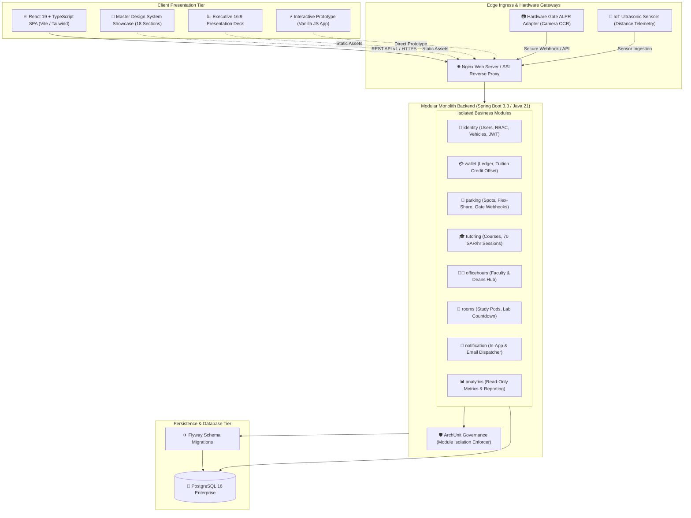

# 🎓 FBSU Smart Campus & ALPR Smart Parking Platform
### 🏛️ University Enterprise SaaS — Modular Monolith Architecture, Interactive Design System & Live Applications

---

<p align="center">
  
</p>

<p align="center">
  <strong>Fahad Bin Sultan University (FBSU) — Tabuk, Kingdom of Saudi Arabia</strong><br>
  <em>An all-in-one smart campus ecosystem orchestrating AI-powered parking management, peer-to-peer student economic empowerment, and automated academic resource reservation.</em>
</p>

<p align="center">
  <!-- Status & Technology Badges -->
  <a href="#-technology-stack"></a>
  <a href="#-technology-stack"></a>
  <a href="#-technology-stack"></a>
  <a href="#-technology-stack"></a>
  <a href="#-technology-stack"></a>
  <a href="#-design-system--visual-showcase"></a>
  <a href="#-executive-overview--vision-2030-alignment"></a>
</p>

---

## 📑 Table of Contents

1. [🌟 Executive Overview & Vision 2030 Alignment](#-executive-overview--vision-2030-alignment)
2. [📸 Visual Walkthrough & System Screenshots](#-visual-walkthrough--system-screenshots)
3. [🏛️ Core Functional Pillars](#️-core-functional-pillars)
4. [🏗️ System Architecture & Engineering Blueprint](#️-system-architecture--engineering-blueprint)
5. [📁 Monorepo Directory Architecture](#-monorepo-directory-architecture)
6. [🎨 Design System & Showcase Portal](#-design-system--showcase-portal)
7. [💻 Technology Stack](#-technology-stack)
8. [🚀 Getting Started & Local Development](#-getting-started--local-development)
9. [🌐 Live Entry Points & Interactive Portals](#-live-entry-points--interactive-portals)
10. [🔒 Security, Compliance & Data Integrity](#-security-compliance--data-integrity)
11. [📚 Engineering Documentation Library](#-engineering-documentation-library)
12. [🤝 Contributing & Development Workflow](#-contributing--development-workflow)

---

## 🌟 Executive Overview & Vision 2030 Alignment

The **FBSU Smart Campus & ALPR Smart Parking Platform** represents a flagship digital transformation initiative at **Fahad Bin Sultan University** in Tabuk, Saudi Arabia. Aligned directly with the technological modernization goals of **Saudi Vision 2030**, the platform bridges physical campus infrastructure with real-time academic workflows through an enterprise-grade **Modular Monolith** architecture.

### Key Value Propositions
- 🚘 **Zero-Touch Campus Transit:** Eliminates paper tickets, physical gate barriers, and bottleneck queues through high-accuracy (98.4%+) Automatic License Plate Recognition (ALPR).
- 🎓 **Student Peer-to-Peer Economy:** Empowers high-achieving students to earn **70 SAR/hour** through certified peer tutoring, routed directly as tuition credit into an immutable financial ledger.
- 👨‍🏫 **Transparent Academic Leadership:** Direct scheduling with College of Computing leadership, department chairs, and professors for capstone reviews and coursework consultations.
- 🔬 **Algorithmic Study Resource Scheduling:** Collision-free booking of smart pods and computer labs backed by PostgreSQL GiST exclusion constraints and real-time evacuation timers.
- 🎨 **Enterprise Design Integrity:** An 18-section tokenized Figma design system featuring responsive light and dark themes with zero layout shifts across desktop, tablet, and mobile displays.

---

## 📸 Visual Walkthrough & System Screenshots

The system combines intuitive user interfaces with dense real-time operational telemetry. Below is a tour of the core interfaces:

### 1. Hero Header & Live KPI Dashboard
The central command bar features dynamic weather and campus status telemetry, active spot counts, rapid action triggers, and seamless dual-theme (Dark/Light) switching.

<p align="center">
  
</p>

---

### 2. Interactive 30-Spot IoT Parking Grid
A high-contrast visual grid tracking all 30 campus parking spots with color-coded status badges (Available, Occupied, Reserved, Maintenance), real-time occupancy percentages, and one-click slot booking.

<p align="center">
  
</p>

---

### 3. ALPR Smart Gate & License Plate OCR Engine
Simulates camera-driven automated gate access, optical character recognition for standard Saudi license plates (Arabic letters & numbers), vehicle authorization verification, and gate barrier actuation.

<p align="center">
  
</p>

---

### 4. Real-Time Telemetry & Ultrasonic Sensor Simulator
Configurable simulation suite enabling operators to trigger entry/exit events, inject sensor distance readings (cm), and validate IoT event pipelines in real time.

<p align="center">
  
</p>

---

### 5. Instant Reservation & Encrypted QR Receipt
Comprehensive modal providing booking duration selection, vehicle license assignment, transparent cost calculation (SAR), and an encrypted, scannable QR pass for campus gate validation.

<p align="center">
  
</p>

---

### 6. Student Economy & Tuition Balance Offset Ledger
Visual breakdown of student earnings accrued from the 70 SAR/hour peer tutoring program, showing total earnings, pending settlements, and automated credit deductions applied to university tuition fees.

<p align="center">
  
</p>

---

### 7. Campus Analytics, Peak-Hour Trends & Sustainability Metrics
Real-time data visualization illustrating peak entry hours, weekly utilization curves, average stay durations, and carbon emission reductions enabled by optimized transit.

<p align="center">
  
</p>

---

### 8. Master Figma Design Canvas & Component Inventory
The master design system workspace spanning 18 distinct architectural sections, including atomic components, layout grids, modal dialogs, and comprehensive state transitions.

<p align="center">
  
</p>

---

### 9. Multi-Device Responsive Adaptability
Fluid responsive layouts meticulously engineered and tested across mobile viewports (iOS/Android), tablets, and high-DPI desktop displays.

<p align="center">
  
</p>

---

### 10. Design Tokens, Typography & Brand Hierarchy
Tokenized design variables establishing university brand identity (`FBSU Teal: #116E63`, `FBSU Gold: #D7A237`), accessible contrast ratios, and typography scales (Alexandria, Tajawal, JetBrains Mono).

<p align="center">
  
</p>

---

## 🏛️ Core Functional Pillars

The platform is built upon four interdependent, mission-critical modules:

```
┌────────────────────────────────────────────────────────────────────────────────────────┐
│                        FBSU SMART CAMPUS UNIFIED PLATFORM                              │
├─────────────────────┬─────────────────────┬─────────────────────┬──────────────────────┤
│  🎓 PEER TUTORING   │  👨‍🏫 OFFICE HOURS    │  🔬 STUDY ROOMS     │  🚗 SMART PARKING    │
│  & STUDENT ECONOMY  │  & DEAN'S HUB       │  & SMART PODS       │  & ALPR GATE         │
├─────────────────────┼─────────────────────┼─────────────────────┼──────────────────────┤
│ • 70 SAR / Hour     │ • Direct Dean Chat  │ • Pod Reservation   │ • 30 Live Spots      │
│ • Tuition Offset    │ • Logic Design Hub  │ • Countdown Timers  │ • Sub-2s ALPR OCR    │
│ • Audit Ledger      │ • Instant Calendar  │ • Lab Overlap Check │ • Flex-Share Market  │
└─────────────────────┴─────────────────────┴─────────────────────┴──────────────────────┘
```

### 1. Peer Tutoring & Student Economy
* **Peer Teaching Rate:** Qualified honors students host approved tutoring sessions at a standardized rate of **70 SAR/hour**.
* **Tuition Fee Offsetting:** Tutoring earnings automatically accumulate in the student's institutional account, seamlessly reducing subsequent semester tuition invoices.
* **Double-Entry Ledger:** All credit transfers and balances are backed by an append-only transaction ledger (`CHECK (balance >= 0)`) to eliminate fraudulent or erroneous adjustments.

### 2. Faculty & Dean Office Hours Hub
* **College of Computing Direct Booking:** Dedicated appointment windows with the Dean of Computing and department department chairs.
* **Topic-Based Routing:** Sessions categorized into Senior Graduation Projects, Logic Design coursework support, academic advising, and general consultations.
* **Omnichannel Notifications:** Instant in-app alerts and official university email confirmations for both student and professor upon booking confirmation or schedule adjustments.

### 3. Study Rooms & Smart Lab Pods
* **Precision Scheduling:** Workgroup reservation for collaborative study cabins and hardware computer laboratories.
* **Digital Evacuation Timer:** Prominent on-screen countdown clocks enforcing prompt departure and fair resource availability for subsequent workgroups.
* **Zero Double-Booking Guarantee:** Protected at the database engine level via PostgreSQL `tstzrange` exclusion constraints.

### 4. ALPR Smart Parking & Flex-Share Marketplace
* **30-Spot Intelligent Grid:** Real-time spot occupancy detection backed by simulated IoT ultrasonic sensors.
* **ALPR Optical Recognition:** Automatic verification of Saudi alphanumeric license plates in under two seconds.
* **Flex-Share Capability:** Faculty and students holding reserved parking slots can temporarily release their unused spots into the public pool when departing campus, earning credits in return.

---

## 🏗️ System Architecture & Engineering Blueprint

The backend is engineered as a **Modular Monolith** in Java 21 LTS and Spring Boot 3.3+. This pattern guarantees strict domain isolation without the distributed network overhead, complex orchestration, or latency penalties of microservices:



### Architectural Guarantees:
1. **Module Autonomy:** Modules communicate solely via published `application` interfaces or domain events. Cross-module database repository access is strictly forbidden and verified via **ArchUnit** tests.
2. **Financial Atomicity:** Wallet transactions use transactional append-only ledger entries with optimistic locking (`@Version`) to guarantee zero race conditions.
3. **Database-Enforced Scheduling:** Study room and parking reservations use `btree_gist` exclusion constraints on temporal ranges (`tstzrange`) to physically prevent overlapping bookings.

---

## 📁 Monorepo Directory Architecture

The repository adheres to a clean, standardized monorepo layout:

```text
├── 📂 design-system/ (legacy/)   # 🎨 Master Design System & Executive Presentations
│   ├── showcase.html             # 🖼️ Figma Master Showcase (18 comprehensive sections)
│   ├── presentation.html         # 📊 Executive Presentation Pitch Deck (16:9 widescreen)
│   ├── README.md                 # 📖 Design system specification & component inventory
│   └── scripts/                  # ⚙️ Python automation assemblers for Figma sections
│       └── build/                # Modular python section builders
├── 📂 frontend/                  # ⚛️ Production Web Application (React 19 + TypeScript + Vite)
│   ├── src/                      # Application components, hooks, state, and routes
│   └── package.json              # Modern frontend dependency tree
├── 📂 backend/                   # ☕ Core Modular Monolith (Java 21 + Spring Boot 3 + PostgreSQL)
│   └── src/main/java/sa/edu/fbsu/# Business modules (identity, wallet, parking, tutoring, ...)
├── 📂 docs/                      # 📚 Comprehensive Technical & Project Documentation
│   ├── architecture/             # System blueprints, ADRs, and Database ERD
│   ├── decisions/                # Architecture Decision Records (ADRs 0001 - 0003)
│   ├── discovery/                # Requirement audits, UI inventory, and scope analysis
│   ├── runbooks/                 # Deployment, operations, and maintenance runbooks
│   └── tasks/                    # Implementation tasks & PDF packages (Phases P0 to P9)
├── 📂 public/                    # 🌐 Shared Public Static Assets
│   ├── favicon.svg               # Official campus platform favicon
│   └── assets/
│       ├── branding/             # High-res university logos & campus photography
│       ├── docs/                 # Official presentation documents (PPTX)
│       └── slides/               # High-fidelity screenshots for all system screens
├── 📂 src/                       # 💻 Interactive Prototype Source (CSS & Logic)
│   ├── css/style.css             # Theme variables, layouts, and typography
│   └── js/                       # Real-time state management and gate simulators
├── 📄 app.html                   # 🚗 Interactive Application Prototype
├── 📄 vite.config.js             # Unified Vite bundler configuration
├── 📄 package.json               # Root monorepo scripts & dependencies
├── 📄 TASKS.md                   # Engineering backlog and milestone tracker
├── 📄 plan.md                    # Strategic implementation roadmap
├── 📄 CHANGELOG.md               # Version history and milestone release log
└── 📄 CONTRIBUTING.md            # Contribution guidelines, commit rules, and branch policy
```

---

## 🎨 Design System & Showcase Portal

Located under [`design-system/`](./design-system/), the master design system provides an interactive Figma-grade experience across 18 specialized sections:

| # | Section Name | Description & Visual Capabilities |
| :-: | :--- | :--- |
| **01** | `Header & Global Nav` | Responsive branding, theme toggle, campus connectivity status, active notifications. |
| **02** | `Hero & Live KPIs` | Instant statistics: 30 live spots, real-time occupancy rates, student earnings metric. |
| **03** | `30-Spot Visual Grid` | Color-coded slot cards (Available, Occupied, Reserved, Maintenance) with quick-actions. |
| **04** | `IoT Sensor Telemetry` | Real-time ultrasonic sensor distance readings and hardware health diagnostics. |
| **05** | `Live Event Simulator` | Interactive console to inject entry/exit events and test ALPR triggers. |
| **06** | `ALPR Gate Camera` | Computer vision gate inspection view with OCR scanning of Saudi license plates. |
| **07** | `Booking & Digital Pass` | Time-slot selection modal with encrypted QR receipt generation and pricing breakdown. |
| **08** | `Flex-Share Exchange` | Peer-to-peer parking spot marketplace for temporary reservation handoffs. |
| **09** | `University Wallet` | Student balance ledger tracking tutoring hours earned and automated tuition deductions. |
| **10** | `Analytics & Reports` | Graphical representations of peak hours, stay durations, and carbon emission offsets. |
| **11** | `Institutional Auth` | Single Sign-On (SSO) login cards supporting Student, Faculty, and Admin roles. |
| **12** | `Footer & Meta Info` | University contacts, campus emergency channels, and active software versioning. |
| **13** | `Device Form Factors` | Side-by-side previews on iPhone 16 Pro, iPad Pro, and UltraWide Desktop displays. |
| **14** | `Design Tokens & Colors` | Complete token matrix: `--fbsu-teal: #116E63`, `--fbsu-gold: #d7a237`, typography. |
| **15** | `System Architecture` | Embedded architectural flowcharts demonstrating service-to-database communication. |
| **16** | `Peer Tutoring Hub` | Course listing, tutor discovery, and 70 SAR/hr peer booking interface. |
| **17** | `Office Hours Hub` | Faculty booking interface for College of Computing chairs and Dean appointments. |
| **18** | `Smart Study Rooms` | Collaborative pod scheduling with digital countdown evacuation timers. |

---

## 💻 Technology Stack

| Domain | Technology | Version | Purpose & Selection Justification |
| :--- | :--- | :---: | :--- |
| **Backend Framework** | Java / Spring Boot | 21 LTS / 3.3+ | Enterprise reliability, native virtual threads (Loom), and strict compile-time type safety. |
| **Frontend Framework** | React / TypeScript | 19 / 5.6+ | Declarative component hierarchy, high rendering speed, and strict interface type checking. |
| **Bundler & Tooling** | Vite | 8.3+ | Sub-second Hot Module Replacement (HMR) and optimized static production bundles. |
| **Database Engine** | PostgreSQL | 16+ | Native `NUMERIC(12,2)` monetary math, `tstzrange` exclusion constraints for collision-free bookings. |
| **Security & Auth** | Spring Security / JWT | 6+ | Stateless token-based access with short expiration windows and automated refresh token rotation. |
| **Architecture Quality** | ArchUnit | 1.3+ | Automated compile-time enforcement of modular boundaries and dependency directions. |
| **Design & UI Styling** | Native CSS3 Variables | Modern | Zero-runtime CSS variable engine guaranteeing instantaneous dark/light theme switching. |
| **Design Automation** | Python 3 | 3.11+ | Automated scripts assembling modular HTML sections into consolidated Figma showcase boards. |

---

## 🚀 Getting Started & Local Development

### Prerequisites
Ensure your local development environment has the following installed:
- **Node.js:** v20.0.0 LTS or higher (`node -v`)
- **Python:** v3.10.0 or higher (`python --version`)
- **Java Development Kit (JDK):** v21 LTS (`java -version`)
- **PostgreSQL (Optional for Backend dev):** v16+

---

### 1. Installation
Clone the repository and install all root and frontend dependencies:
```bash
# Clone the repository
git clone https://github.com/fbsu-dev/smart-campus.git
cd smart-campus

# Install root dependencies
npm install
```

### 2. Launch Local Development Server
Start the unified Vite development server:
```bash
npm run dev
```
The server will boot locally at:
👉 **`http://localhost:5173/`**

### 3. Rebuild the Figma Design System Showcase
To recompile the 18 design sections into a unified HTML showcase file:
```bash
npm run build:showcase
```
*Output generated at:* [`design-system/showcase.html`](./design-system/showcase.html)

### 4. Create Production Distribution Build
Generate clean, minified, and optimized assets for production deployment:
```bash
npm run build
```
The production bundle will be exported to the `dist/` directory ready for deployment on Nginx or any cloud hosting environment.

### 6. Run with Docker Compose (Full-Stack Containerized)
You can launch PostgreSQL, the Spring Boot modular backend, and the React frontend in containers with a single command:
```bash
# Copy example environment configuration
cp .env.example .env

# Build and start all services
docker compose up --build -d

# Check health of all containers
docker compose ps
```
- **Frontend SPA (Nginx):** `http://localhost:3000`
- **Backend API:** `http://localhost:8080/api/v1`
- **PostgreSQL Database:** `localhost:5432`

---

## 🌐 Live Entry Points & Interactive Portals

When running the local server (`npm run dev`), you can directly access any of the application portals:

| Portal | Local URL | Description |
| :--- | :--- | :--- |
| **🚗 Live Interactive Application** | [`/app.html`](http://localhost:5173/app.html) | Interactive simulation of parking spots, ALPR camera, and student services. |
| **🎨 Master Design System Showcase** | [`/legacy/showcase.html`](http://localhost:5173/legacy/showcase.html) *(or `/design-system/`)* | 18-section Figma design system with dual light/dark themes. |
| **📊 Executive Pitch Deck** | [`/legacy/presentation.html`](http://localhost:5173/legacy/presentation.html) *(or `/design-system/`)* | 16:9 widescreen presentation deck tailored for university leadership. |
| **⚛️ Modern React Frontend** | [`/frontend/`](http://localhost:5173/frontend/) | Next-generation React 19 + TypeScript production application. |

---

## 🔒 Security, Compliance & Data Integrity

1. **Immutable Append-Only Financial Ledger:**
   - Every peer tutoring hour earned and tuition fee deduction is recorded as an immutable ledger transaction.
   - Balances are derived dynamically and protected by database constraints (`CHECK (balance >= 0)`) and optimistic concurrency locking (`@Version`).

2. **Mathematical Reservation Isolation:**
   - Resource scheduling (parking spots, study rooms, labs) utilizes PostgreSQL GiST indexing with `tstzrange` exclusion constraints:
   ```sql
   ALTER TABLE room_booking 
   ADD CONSTRAINT no_room_overlap 
   EXCLUDE USING gist (room_id WITH =, booking_interval WITH &&);
   ```
   *Guarantees zero overlapping reservations even under high concurrency.*

3. **Stateless Role-Based Access Control (RBAC):**
   - Fine-grained permission matrix separating `STUDENT`, `FACULTY`, `DEPARTMENT_CHAIR`, and `CAMPUS_ADMIN`.
   - Passwords salted and hashed with **BCrypt (Cost Factor 12)**.
   - Ephemeral JWT access tokens (15-minute expiration) paired with rotating refresh tokens.

---

## 📚 Engineering & Product Documentation Library

### 1. Product & Features (منظور المنتج والميزات)
| Document | File Path | Focus Area |
| :--- | :--- | :--- |
| **Product Overview** | [`docs/product/PRODUCT_OVERVIEW.md`](./docs/product/PRODUCT_OVERVIEW.md) | الرؤية الشاملة لمنظومة CampusFlow، المشاكل التي تحلها، والقيمة المقدمة. |
| **Feature Catalog** | [`docs/product/FEATURE_CATALOG.md`](./docs/product/FEATURE_CATALOG.md) | كتالوج الـ 16 ميزة المكتشفة مع 20 مؤشراً لكل ميزة (الوضع الراهن، الاعتماديات، والاختبارات). |
| **Feature Dependencies** | [`docs/product/FEATURE_DEPENDENCIES.md`](./docs/product/FEATURE_DEPENDENCIES.md) | مخطط الاعتماديات التفاعلي (Mermaid Graph) والمسار الحرج للمشروع. |
| **Feature Priority Matrix** | [`docs/product/FEATURE_PRIORITY_MATRIX.md`](./docs/product/FEATURE_PRIORITY_MATRIX.md) | مصفوفة الأولويات (P0 إلى P3) بناءً على القيمة، الأثر، والأمان. |
| **User Journeys & Value** | [`docs/product/USER_JOURNEYS.md`](./docs/product/USER_JOURNEYS.md) | رحلات المستخدم اليومية والإجابة على الأسئلة الستة الجوهرية بالعامية المصرية. |
| **Feature Status Report** | [`docs/product/FEATURE_STATUS_REPORT.md`](./docs/product/FEATURE_STATUS_REPORT.md) | لوحة متابعة حالة الميزات (Frontend, Backend, DB, Integration, Testing, Overall). |

### 2. Planning & Delivery (التخطيط والسبرنتات)
| Document | File Path | Focus Area |
| :--- | :--- | :--- |
| **Master Delivery Plan** | [`plan.md`](./plan.md) | الخطة الإستراتيجية العامة، المعمارية المعتمدة، وقواعد التطوير الصارمة. |
| **Feature-Driven Task Registry** | [`TASKS.md`](./TASKS.md) | سجل المهام الشامل الموجه بالميزات — 53 مهمة مربوطة بالـ Feature IDs وفروع العمل. |
| **Master Roadmap** | [`docs/planning/MASTER_ROADMAP.md`](./docs/planning/MASTER_ROADMAP.md) | خارطة الطريق من الوضع الراهن حتى الإصدار الإنتاجي v1.0. |
| **Sprint Roadmap** | [`docs/planning/SPRINT_ROADMAP.md`](./docs/planning/SPRINT_ROADMAP.md) | توزيع العمل بالسبرنتات (Sprints 01 to 07 Done, Sprint 08 Active, Sprints 09-10). |
| **Sprint Backlog** | [`docs/planning/SPRINT_BACKLOG.md`](./docs/planning/SPRINT_BACKLOG.md) | قائمة مهام السبرنت النشط (P7-05 Admin UI و P7-06 Analytics) والسبرنتات القادمة. |
| **Completed Work Register** | [`docs/planning/COMPLETED_WORK.md`](./docs/planning/COMPLETED_WORK.md) | سجل المهام الـ 42 المنجزة والمفحوصة بنسبة 100% مع أرقام الـ PRs. |
| **Blocked Work Register** | [`docs/planning/BLOCKED_WORK.md`](./docs/planning/BLOCKED_WORK.md) | سجل المهام المحجوبة باعتماديات والتكاملات الخارجية المطلوبة مستقبلاً. |

### 3. Architecture & Quality (المعمارية وضمان الجودة)
| Document | File Path | Focus Area |
| :--- | :--- | :--- |
| **System Architecture** | [`docs/architecture/SYSTEM_ARCHITECTURE.md`](./docs/architecture/SYSTEM_ARCHITECTURE.md) | المعمارية البرمجية الحية للمونوليث النمطي ومخططات التدفق والأمان والـ Event Bus. |
| **Database Overview** | [`docs/architecture/DATABASE_OVERVIEW.md`](./docs/architecture/DATABASE_OVERVIEW.md) | التوثيق الشامل لـ 21 جدولاً في PostgreSQL 15 وهجرات Flyway الـ 14 وقاموس البيانات. |
| **Acceptance Criteria** | [`docs/quality/FEATURE_ACCEPTANCE_CRITERIA.md`](./docs/quality/FEATURE_ACCEPTANCE_CRITERIA.md) | ميثاق Definition of Done ومعايير قبول كل ميزة بدقة. |

---

## 🤝 Contributing & Development Workflow

1. Review the contribution guidelines in [`CONTRIBUTING.md`](./CONTRIBUTING.md).
2. Branch naming convention: `feature/P<Phase>-<TaskID>-short-title` (e.g., `feature/P1-02-frontend-scaffold`).
3. Ensure all tests and static analysis checks pass before submitting a pull request:
   ```bash
   npm run build
   ```
4. Verify that no cross-module repository violations are introduced in the backend code.

---

<p align="center">
  <strong>© 2026 Fahad Bin Sultan University (FBSU). All Rights Reserved.</strong><br>
  <em>Designed and engineered with precision for Fahad Bin Sultan University, Tabuk, KSA.</em>
</p>
