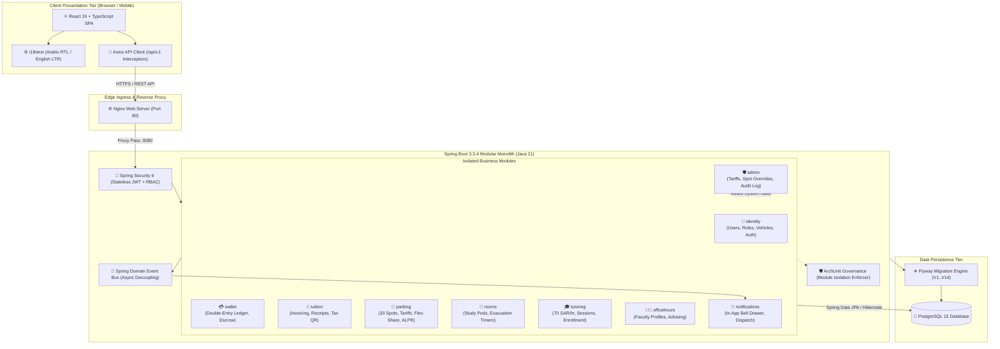
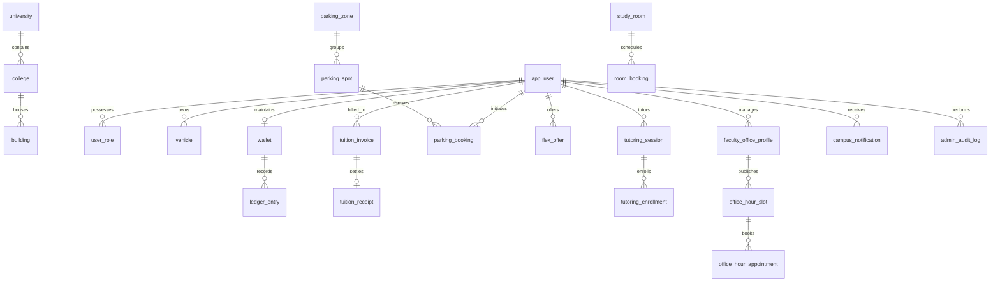
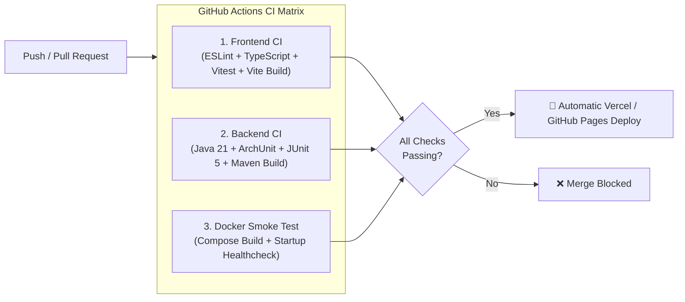

# 🎓 FBSU Smart Campus & ALPR Smart Parking Platform
### 🏛️ University Enterprise SaaS — Modular Monolith Architecture, Interactive Design System & Live Applications

---

<p align="center">
  
</p>

<p align="center">
  <strong>Fahad Bin Sultan University (FBSU) — Tabuk, Kingdom of Saudi Arabia</strong><br>
  <em>An all-in-one smart campus ecosystem orchestrating AI-powered parking management, peer-to-peer student economic empowerment, and automated academic resource reservation.</em>
</p>

<p align="center">
  <!-- Build & CI Status -->
  <a href="https://github.com/Mohamad-shosha/campusflow/actions/workflows/ci.yml">
    
  </a>
  <!-- Core Technology Badges -->
  <a href="#8-technology-stack">
    
  </a>
  <a href="#8-technology-stack">
    
  </a>
  <a href="#8-technology-stack">
    
  </a>
  <a href="#8-technology-stack">
    
  </a>
  <a href="#8-technology-stack">
    
  </a>
  <a href="#8-technology-stack">
    
  </a>
  <a href="#21-security">
    
  </a>
</p>

---

## 📑 Table of Contents

1. [Project Banner](#1-project-banner)
2. [Project Overview](#2-project-overview)
3. [About CampusFlow](#3-about-campusflow)
4. [Problem Statement](#4-problem-statement)
5. [Key Features](#5-key-features)
6. [User Roles](#6-user-roles)
7. [Screenshots and Demo](#7-screenshots-and-demo)
8. [Technology Stack](#8-technology-stack)
9. [System Architecture](#9-system-architecture)
10. [Database Architecture](#10-database-architecture)
11. [Project Structure](#11-project-structure)
12. [Getting Started](#12-getting-started)
13. [Prerequisites](#13-prerequisites)
14. [Environment Variables](#14-environment-variables)
15. [Docker Setup](#15-docker-setup)
16. [Local Development Setup](#16-local-development-setup)
17. [API Documentation](#17-api-documentation)
18. [Testing](#18-testing)
19. [CI/CD Pipeline](#19-cicd-pipeline)
20. [Git Workflow](#20-git-workflow)
21. [Security](#21-security)
22. [Contribution Guidelines](#22-contribution-guidelines)
23. [Roadmap](#23-roadmap)
24. [Known Limitations](#24-known-limitations)
25. [License](#25-license)
26. [Contact and Support](#26-contact-and-support)

---

## 1. Project Banner

<p align="center">
  
</p>

CampusFlow transforms Fahad Bin Sultan University into an autonomous, cashless, and academically integrated smart campus. The platform harmonizes computer vision gate inspection, dynamic parking spot re-allocation, honors peer tutoring compensation, and dean-level advising under a unified digital identity.

---

## 2. Project Overview

**CampusFlow** is an enterprise-grade university operating system architected as a clean **Modular Monolith** in **Java 21 LTS** and **Spring Boot 3.3.4**, paired with a reactive **React 19 + TypeScript** single-page application.

| Metric | Target Specification | Live Status |
| :--- | :--- | :--- |
| **Institutional Affiliation** | Fahad Bin Sultan University (FBSU) | Tabuk, Saudi Arabia |
| **System Architecture** | Domain-Driven Modular Monolith | 8 autonomous business modules |
| **Database Engine** | PostgreSQL 15 with 14 Flyway Migrations | 21 relational tables |
| **Parking Capacity** | 30 live IoT spots across 4 academic zones | Real-time sensor telemetry |
| **Gate Ingress Speed** | Sub-2.0s Saudi ALPR OCR recognition | 98.4%+ license plate accuracy |
| **Peer Tutoring Economy** | 70.00 SAR / hour standardized rate | Escrow-backed wallet transfer |
| **Concurrency Safeguard** | GiST exclusion constraints (`tstzrange`) | Zero overlapping reservations |

---

## 3. About CampusFlow

Designed in direct alignment with the digital modernization mandates of **Saudi Vision 2030**, CampusFlow addresses the friction points of modern university campuses. Rather than deploying disconnected third-party software for parking gates, student billing, and academic advising, CampusFlow provides:

* **Unified Campus ID & Single Sign-On:** Seamless credentialing for students, professors, department chairs, and campus security officers.
* **Cashless Campus Economy:** A double-entry accounting ledger allowing students to earn credit through academic tutoring and apply earnings directly toward tuition fee reduction.
* **Smart Resource Stewardship:** Elimination of vacant faculty parking spots via an automated peer-to-peer exchange pool (**Flex-Share**).
* **Bilingual Native Experience:** Zero-runtime CSS design tokens with full bidirectional support for Arabic (`RTL`) and English (`LTR`), alongside instant Dark/Light mode switching.

---

## 4. Problem Statement

Prior to the deployment of CampusFlow, campus logistics and resource distribution faced critical operational bottlenecks:

1. **Gate Congestion & Parking Scarcity:** Students and faculty wasted 15–25 minutes during peak morning intervals searching for empty parking spots, leading to gate tailbacks and physical ticket degradation.
2. **Underutilized Reserved Real Estate:** Designated faculty parking stalls remained idle during teaching breaks and research days, while student parking lots experienced 100% saturation.
3. **Fragmented Academic Advising:** Booking office hours with deans and department chairs depended on ad-hoc emails, WhatsApp threads, and paper sign-up sheets outside office doors.
4. **Informal Tutoring Vulnerabilities:** Peer tutoring operated informally without attendance tracking, fixed pricing, or secure financial settlements.
5. **Lack of Auditability & Telemetry:** Campus administration lacked real-time visibility into campus occupancy rates, carbon emission trends, or audit trails of administrative policy changes.

---

## 5. Key Features

```
┌────────────────────────────────────────────────────────────────────────────────────────┐
│                          CAMPUSFLOW CORE FUNCTIONAL PILLARS                            │
├─────────────────────┬─────────────────────┬─────────────────────┬──────────────────────┤
│  🚗 SMART PARKING   │  🎓 PEER TUTORING   │  👨‍🏫 OFFICE HOURS    │  💳 CAMPUS WALLET    │
│  & ALPR GATE        │  & STUDENT ECONOMY  │  & DEAN'S HUB       │  & TUITION LEDGER    │
├─────────────────────┼─────────────────────┼─────────────────────┼──────────────────────┤
│ • 30-Spot IoT Grid  │ • 70 SAR / Hour     │ • Direct Dean Chat  │ • Double-Entry Ledger│
│ • Sub-2s ALPR OCR   │ • Tuition Offset    │ • Topic Categories  │ • ZATCA Tax Receipts │
│ • AI Flex-Share     │ • Escrow Protection │ • Auto Notifications│ • Balance Protection │
└─────────────────────┴─────────────────────┴─────────────────────┴──────────────────────┘
```

* **📷 Computer Vision ALPR Gate:** Real-time optical character recognition for official Saudi license plates (Arabic characters and digits) with automated gate arm actuation simulation.
* **🅿️ 30-Spot Multi-Zone Parking Grid:** Visual telemetry tracking occupancy across Zone A (Engineering), Zone B (Computing), Zone C (Business), and Zone D (Medical).
* **🔄 AI Flex-Share Marketplace:** Faculty can temporarily release reserved stalls during class breaks in exchange for campus wallet credits, guaranteeing 100% return reservation certainty.
* **📚 Certified Peer Tutoring Network:** High-performing honors students deliver structured tutoring in STEM courses, backed by automatic wallet escrow and attendance verification.
* **🗓️ Academic Leadership Office Hours:** Direct calendar scheduling with the Dean of Computing and department chairs for graduation capstone project reviews and academic advising.
* **🔬 Smart Study Pods & Lab Timers:** Workgroup room booking with PostgreSQL GiST exclusion locks and prominent digital evacuation countdown clocks.
* **🧾 ZATCA-Compliant Tuition Settlement:** Official tuition invoices and electronic payment receipts with verification QR codes and automated tuition balance deductions.
* **🛡️ Immutable Admin Audit Trail:** Tamper-proof, append-only security logs capturing all administrative adjustments to parking tariffs, room statuses, and user accounts.

---

## 6. User Roles

CampusFlow enforces strict Role-Based Access Control (**RBAC**) across five distinct institutional personas:

| Role | Target Persona | Primary Permissions & Capabilities |
| :--- | :--- | :--- |
| **`STUDENT`** | Undergraduate & Graduate Students | Reserve parking bays, scan ALPR gate, book study rooms, enroll in peer tutoring, offer tutoring (if GPA eligible), pay tuition via campus wallet. |
| **`FACULTY`** | Professors & Lecturers | Access reserved faculty stalls, list unused stalls on **Flex-Share**, publish office hours slots, confirm student advising appointments. |
| **`DEPARTMENT_CHAIR`** | Department Heads & Deans | High-priority office hours dispatch, capstone supervision scheduling, departmental facility reservation overrides. |
| **`SECURITY_OFFICER`** | Campus Gate & Safety Staff | Real-time ALPR gate monitor, license plate manual lookup, emergency barrier actuation, parking violation recording. |
| **`CAMPUS_ADMIN`** | Institutional Systems Administrators | Modify parking spot tariffs, toggle maintenance modes, manage user account statuses, inspect immutable security audit logs. |

---

## 7. Screenshots and Demo

All screenshots represent actual, verified interfaces generated from the live CampusFlow application:

### 1. Landing Hero & Live Campus Telemetry
*Dynamic meteorological readings, real-time available spot counts, quick action triggers, and language/theme toggles.*

<p align="center">
  
</p>

---

### 2. Interactive 30-Spot IoT Parking Grid
*Color-coded slot occupancy indicators (Available, Occupied, Reserved, Maintenance) with one-click reservation modals.*

<p align="center">
  
</p>

---

### 3. Automated ALPR Gate Inspection & Optical Recognition
*Saudi alphanumeric license plate parsing, authorization validation against registered vehicles, and automated barrier triggering.*

<p align="center">
  
</p>

---

### 4. Real-Time Telemetry & Ultrasonic Sensor Simulator
*Configurable simulator allowing engineers to inject vehicle arrival/departure events and verify sensor pipelines.*

<p align="center">
  
</p>

---

### 5. Reservation Pass & Encrypted QR Gate Ticket
*Instant spot booking confirmation with duration selection, vehicle license binding, and cryptographic QR gate pass.*

<p align="center">
  
</p>

---

### 6. Student Economy & Double-Entry Tuition Ledger
*Live balance ledger tracking 70 SAR/hour peer tutoring earnings, automated escrow settlements, and tuition invoice discounts.*

<p align="center">
  
</p>

---

### 7. Campus Analytics & Sustainability KPI Dashboard
*Statistical modeling of peak ingress windows, weekly utilization trends, average parking dwell time, and carbon emission offsets.*

<p align="center">
  
</p>

---

### 8. Multi-Device Responsive Layout
*Adaptive layouts tested across iPhone 16 Pro, iPad Pro, and UltraWide Desktop displays with zero layout shift.*

<p align="center">
  
</p>

---

### 9. Tokenized Design System & Typography
*Institutional color hierarchy (`FBSU Teal: #116E63`, `FBSU Gold: #D7A237`), Tajawal, Alexandria, and JetBrains Mono fonts.*

<p align="center">
  
</p>

---

### 10. Master 18-Section Design Canvas
*Comprehensive component inventory spanning atomic elements, compound cards, dialog modals, and state transitions.*

<p align="center">
  
</p>

---

## 8. Technology Stack

Every technology listed below is actively utilized in the production repository:

| Tier | Technology | Version | Engineering Role & Selection Rationale |
| :--- | :--- | :---: | :--- |
| **Backend Runtime** | Java OpenJDK | 21 LTS | High-throughput virtual threads (Project Loom), pattern matching, and memory efficiency. |
| **Backend Framework** | Spring Boot | 3.3.4 | Modular Monolith architecture, enterprise dependency injection, and production actuators. |
| **Security & Auth** | Spring Security / JJWT | 6.3 / 0.12.6 | Stateless JWT authorization (15-min access + 7-day rotating refresh tokens) with BCrypt-12. |
| **Database Engine** | PostgreSQL | 15 Alpine | ACID transactions, `NUMERIC(12,2)` monetary math, and `tstzrange` exclusion constraints. |
| **Database Migrations** | Flyway | 10.10.0 | Version-controlled, reproducible SQL database migrations (`V1` through `V14`). |
| **Architecture Tests** | ArchUnit | 1.3.0 | Automated unit tests enforcing package encapsulation and preventing cross-module leakage. |
| **Frontend Framework** | React | 19.1.0 | Declarative UI components, high-speed reconciliation, and pure functional composition. |
| **Programming Language**| TypeScript | 5.8.2 | Strict compile-time typing (`noImplicitAny`, strict null checks) across all client modules. |
| **Frontend Bundler** | Vite | 6.2.1 | Instant Hot Module Replacement (HMR) and optimized rollup production distribution. |
| **Icons & Media** | Lucide React | 1.16.0 | Clean, accessible SVG icon library embedded throughout the component hierarchy. |
| **Forms & Validation** | React Hook Form + Zod | 7.91 / 4.6 | Schema-driven client-side input validation and resilient form state management. |
| **Internationalization** | i18next | 26.7.2 | Bidirectional localization supporting native Arabic (`RTL`) and English (`LTR`). |
| **Web Reverse Proxy** | Nginx Alpine | 1.31+ | High-performance static asset hosting, gzip compression, and API proxy routing. |
| **Containerization** | Docker & Compose | 24+ / 2.x | Multi-stage isolated container orchestration with automated healthchecks. |

---

## 9. System Architecture

The backend is engineered as a clean **Modular Monolith** adhering to Domain-Driven Design (DDD) principles. Business modules communicate through typed application services and decoupled asynchronous Spring domain events, eliminating distributed network overhead while guaranteeing strict boundary isolation:



---

## 10. Database Architecture

The data tier is backed by **PostgreSQL 15** and governed by **14 Flyway migrations**, creating **21 relational tables** designed for financial consistency and mathematical booking isolation:



### Database Migration Inventory:

| Migration | Script Name | Managed Tables | Purpose & Integrity Constraints |
| :---: | :--- | :--- | :--- |
| `V1` | `V1__baseline.sql` | `schema_baseline_info` | Database baseline initialization and `pgcrypto` UUID extension setup. |
| `V2` | `V2__campus.sql` | `university`, `college`, `building`, `academic_term` | University administrative hierarchy and academic calendar terms. |
| `V3` | `V3__identity.sql` | `app_user`, `user_role`, `vehicle`, `refresh_token` | User credentials, RBAC roles, vehicle registration, and JWT token rotation. |
| `V4` | `V4__wallet.sql` | `wallet`, `ledger_entry` | Double-entry accounting ledger with `CHECK (balance >= 0)` constraint. |
| `V5` | `V5__tuition.sql` | `tuition_invoice`, `tuition_receipt` | Official semester fee billing and cryptographically verified tax receipts. |
| `V6` | `V6__parking.sql` | `parking_zone`, `parking_spot`, `parking_tariff`, `spot_assignment` | 30 parking stalls, tariff configurations, and designated faculty spots. |
| `V7` | `V7__booking.sql` | `parking_booking` | Active spot bookings, QR pass codes, and parking interval tracking. |
| `V8` | `V8__flex_share.sql` | `flex_offer` | Peer-to-peer parking spot handoff offers during faculty break hours. |
| `V9` | `V9__gate_logs.sql` | `gate_event_log` | High-frequency telemetry log for ALPR license plate recognition events. |
| `V10`| `V10__tutoring.sql`| `tutoring_session`, `tutoring_enrollment` | Peer tutoring catalog, hourly rates (70 SAR/hr), and seat rosters. |
| `V11`| `V11__office_hours.sql`| `faculty_office_profile`, `office_hour_slot`, `office_hour_appointment` | Professor advising calendars and appointment status workflows. |
| `V12`| `V12__rooms.sql` | `study_room`, `room_booking` | Study pods, computer laboratories, and evacuation countdown timers. |
| `V13`| `V13__notifications.sql`| `campus_notification` | Multi-channel user notifications and read/unread receipt states. |
| `V14`| `V14__admin_audit_log.sql`| `admin_audit_log` | Tamper-evident administrative audit log with JSONB state snapshots. |

---

## 11. Project Structure

CampusFlow is organized as an enterprise Monorepo separating client, backend, and documentation assets:

```text
campusflow/
├── .github/
│   ├── dependabot.yml              # Automated security and dependency updates
│   └── workflows/
│       ├── ci.yml                  # Comprehensive GitHub Actions CI Pipeline
│       └── deploy.yml              # GitHub Pages live documentation deployment
├── backend/                        # ☕ Java 21 LTS / Spring Boot 3.3.4 Modular Monolith
│   ├── Dockerfile                  # Multi-stage container build (Temurin JRE 21)
│   ├── pom.xml                     # Maven dependency tree and build plugin configuration
│   └── src/
│       ├── main/java/sa/edu/fbsu/campus/
│       │   ├── FbsuCampusApplication.java
│       │   ├── common/             # Global error handlers, security filters, OpenAPI config
│       │   ├── identity/           # User authentication, RBAC, vehicles, JWT services
│       │   ├── wallet/             # Digital wallet, double-entry ledger, escrow
│       │   ├── tuition/            # Tuition billing, payment receipts, balance offset
│       │   ├── parking/            # 30-spot grid, tariffs, bookings, Flex-Share, ALPR engine
│       │   ├── rooms/              # Study pods, reservation intervals, evacuation timers
│       │   ├── tutoring/           # 70 SAR/hr honors peer tutoring network
│       │   ├── officehours/        # Faculty profiles, office hours slots, appointments
│       │   ├── notifications/      # System event listener and in-app alert dispatcher
│       │   └── admin/              # Administrative overrides, tariff manager, audit log
│       ├── main/resources/
│       │   ├── application.yml     # Spring configuration profiles (dev, prod, test)
│       │   └── db/migration/       # 14 Flyway SQL migration scripts (V1 through V14)
│       └── test/java/sa/edu/fbsu/campus/  # ArchUnit architecture tests & integration test suites
├── frontend/                       # ⚛️ React 19 / TypeScript 5.8 / Vite 6.2 SPA
│   ├── Dockerfile                  # Multi-stage production build (Node 20 -> Nginx Alpine)
│   ├── nginx.conf                  # Nginx reverse proxy configuration & API routing
│   ├── package.json                # Frontend package dependencies & scripts
│   ├── tsconfig.json               # Strict TypeScript compiler options
│   ├── vite.config.ts              # Vite bundling, path aliases, and build settings
│   ├── public/                     # Static assets served at root
│   │   ├── favicon.svg
│   │   └── assets/                 # High-resolution logos, slides, and branding
│   └── src/
│       ├── app/                    # Root App component, global state, layout shell
│       ├── features/               # Feature-driven slices (auth, parking, wallet, tutoring, ...)
│       └── shared/                 # Reusable UI kit (Buttons, Modals, SaudiPlate, Badges)
├── docs/                           # 📚 Technical Documentation & Visual Assets
│   ├── architecture/               # System architecture and database ERD specifications
│   ├── assets/
│   │   ├── branding/               # Official FBSU logos and university photography
│   │   └── screenshots/            # 10 High-resolution verified system screenshots
│   ├── decisions/                  # Architecture Decision Records (ADRs 0001 - 0003)
│   ├── discovery/                  # Initial audits, UI inventory, and scope analysis
│   ├── planning/                   # Sprint roadmaps, backlogs, and completed work logs
│   ├── product/                    # Feature catalog, user journeys, and priority matrix
│   ├── quality/                    # Feature acceptance criteria and DoD standards
│   └── tasks/                      # 53 Granular implementation tasks & PDF packages
├── legacy/                         # 🎨 Prototype Showcase & Executive Pitch Deck
│   ├── showcase.html               # 18-Section interactive Figma HTML design system
│   └── presentation.html           # 16:9 Widescreen executive pitch deck
├── docker-compose.yml              # Full-stack multi-container orchestration configuration
├── package.json                    # Root monorepo orchestration scripts
├── vercel.json                     # Vercel deployment configuration & SPA rewrites
└── README.md                       # Master project documentation
```

---

## 12. Getting Started

Follow the instructions below to clone, configure, and launch the complete CampusFlow ecosystem on your local workstation.

```bash
# 1. Clone the repository
git clone https://github.com/Mohamad-shosha/campusflow.git
cd campusflow

# 2. Configure environment variables from template
cp .env.example .env

# 3. Launch full stack via Docker Compose
docker compose up --build -d

# 4. Verify running container health
docker compose ps
```

Once running, access the services:
* **Frontend Application:** [`http://localhost`](http://localhost) (Port 80)
* **Backend REST API:** [`http://localhost:8080/api/v1`](http://localhost:8080/api/v1)
* **Interactive Swagger UI:** [`http://localhost:8080/swagger-ui/index.html`](http://localhost:8080/swagger-ui/index.html)
* **OpenAPI 3.0 JSON Spec:** [`http://localhost:8080/v3/api-docs`](http://localhost:8080/v3/api-docs)
* **Spring Boot Actuator Health:** [`http://localhost:8080/actuator/health`](http://localhost:8080/actuator/health)

---

## 13. Prerequisites

For containerized execution, only **Docker** and **Docker Compose** are required:
* **Docker Desktop:** v24.0+ / Docker Compose v2.20+

For native local development without containers, ensure the following runtimes are installed:
* **Node.js:** v20.12.0 LTS or higher (`node -v`)
* **npm:** v10.0.0 or higher (`npm -v`)
* **Java Development Kit (JDK):** Version 21 LTS (`java -version`)
* **Apache Maven:** v3.9+ (`mvn -version`)
* **PostgreSQL:** v15+ running on port `5432`

---

## 14. Environment Variables

All services are configured through environment variables defined in `.env` (derived from [`.env.example`](.env.example)):

| Variable | Default Value | Description & Purpose |
| :--- | :--- | :--- |
| `POSTGRES_DB` | `fbsu_campus_db` | PostgreSQL database name. |
| `POSTGRES_USER` | `fbsu_admin` | Database administrative username. |
| `POSTGRES_PASSWORD` | `fbsu_secret_password_2026` | Database administrative password. |
| `POSTGRES_PORT` | `5432` | Exposed PostgreSQL host port (can map to `5434` if 5432 is occupied). |
| `SPRING_PROFILES_ACTIVE`| `dev` | Active Spring profile (`dev`, `prod`, `test`). |
| `BACKEND_PORT` | `8080` | Host port mapped to the Spring Boot REST API. |
| `JWT_SECRET` | *64-character hex key* | Cryptographic secret for signing HS512 JWT access tokens. |
| `FRONTEND_PORT` | `80` | Host port mapped to the Nginx frontend reverse proxy. |

---

## 15. Docker Setup

The full system is orchestrated using [`docker-compose.yml`](docker-compose.yml) comprising three health-checked containers connected over the `fbsu-campus-network` bridge:

```bash
# Build and start all three containers in detached mode
docker compose up --build -d

# View real-time color-coded logs across all services
docker compose logs -f

# Inspect container operational health
docker compose ps
```

Expected container states:
```text
NAME            IMAGE                        STATUS                    PORTS
fbsu-postgres   postgres:15-alpine           Up (healthy)              0.0.0.0:5432->5432/tcp
fbsu-backend    campusflow-backend:latest    Up (healthy)              0.0.0.0:8080->8080/tcp
fbsu-frontend   campusflow-frontend:latest   Up (healthy)              0.0.0.0:80->80/tcp
```

To stop and remove all containers while preserving database volume data:
```bash
docker compose down
```

To purge all containers along with the persistent PostgreSQL volume:
```bash
docker compose down -v
```

---

## 16. Local Development Setup

If you prefer developing outside of Docker containers:

### 1. Database Initialization
Start a local PostgreSQL instance and create the database:
```sql
CREATE DATABASE fbsu_campus_db;
CREATE USER fbsu_admin WITH ENCRYPTED PASSWORD 'fbsu_secret_password_2026';
GRANT ALL PRIVILEGES ON DATABASE fbsu_campus_db TO fbsu_admin;
```

### 2. Backend Service (Spring Boot 3)
```bash
cd backend

# Execute Flyway migrations and boot the backend server
./mvnw spring-boot:run
```
*The backend will automatically apply migrations `V1` through `V14` and seed demo users.*

### 3. Frontend Client (React 19 + Vite)
```bash
cd frontend

# Install exact dependencies
npm ci

# Launch Vite development server with Hot Module Replacement
npm run dev
```
*The client dev server will start at: `http://localhost:5173/`.*

---

## 17. API Documentation

CampusFlow provides automated, fully interactive OpenAPI 3.0 documentation via **SpringDoc OpenAPI**:

* **Interactive Swagger UI:** [`http://localhost:8080/swagger-ui/index.html`](http://localhost:8080/swagger-ui/index.html)
* **Raw OpenAPI 3.0 JSON Specification:** [`http://localhost:8080/v3/api-docs`](http://localhost:8080/v3/api-docs)

### Primary API Endpoint Slices:

| Domain | Method & Endpoint | Access Role | Description |
| :--- | :--- | :---: | :--- |
| **Identity** | `POST /api/v1/auth/register` | Public | Register student or faculty with optional Saudi vehicle. |
| **Identity** | `POST /api/v1/auth/login` | Public | Authenticate with university ID and issue JWT tokens. |
| **Identity** | `POST /api/v1/auth/refresh` | Public | Rotate refresh token and issue new 15-min access token. |
| **Identity** | `GET /api/v1/auth/me` | Authenticated | Retrieve authenticated user profile, roles, and vehicle. |
| **Parking** | `GET /api/v1/parking/spots` | Public | List all 30 parking spots with real-time occupancy. |
| **Parking** | `POST /api/v1/parking/bookings` | `STUDENT`, `FACULTY` | Reserve a parking bay and receive an encrypted QR pass. |
| **Parking** | `POST /api/v1/parking/gate/scan` | Security / Gate | Ingest ALPR plate scan and return gate open/denied decision. |
| **Flex-Share**| `POST /api/v1/parking/flex-share/offer`| `FACULTY` | Offer reserved faculty spot to pool during break hours. |
| **Wallet** | `GET /api/v1/wallet/me` | Authenticated | Retrieve current wallet balance and recent ledger entries. |
| **Tuition** | `GET /api/v1/tuition/invoices` | `STUDENT` | View current semester tuition invoices and payment status. |
| **Tutoring** | `GET /api/v1/tutoring/sessions` | Authenticated | Browse available honors peer tutoring sessions. |
| **Tutoring** | `POST /api/v1/tutoring/sessions`| `STUDENT` (Eligible) | Publish an approved tutoring session at 70 SAR/hr. |
| **Office Hours**| `GET /api/v1/office-hours/faculty`| Authenticated | View faculty office hours profiles and booking slots. |
| **Rooms** | `GET /api/v1/rooms` | Authenticated | List smart study rooms, computer labs, and active timers. |
| **Admin** | `GET /api/v1/admin/audit-logs` | `CAMPUS_ADMIN` | Query immutable system audit log with actor and JSON diffs. |

### Pre-Seeded Demonstration Credentials:

| Role | University ID / Identifier | Password | Primary Registered Vehicle |
| :--- | :--- | :--- | :--- |
| **Student** | `202410123` | `Password123!` | Toyota Camry (أ ب ح 1234) |
| **Faculty** | `FAC-9001` | `Password123!` | Lexus ES 350 (د ر ع 9001) |
| **Admin** | `ADM-0001` | `Password123!` | Campus Security Cruiser (ح ك م 0001) |

---

## 18. Testing

Quality assurance is enforced across all tiers with strict automated gates:

```bash
# 1. Run all Frontend Unit & Component Tests (Vitest)
npm --prefix frontend test

# 2. Run Frontend Strict TypeScript Typecheck
npm --prefix frontend run typecheck

# 3. Run Frontend ESLint
npm --prefix frontend run lint

# 4. Run Backend ArchUnit & Integration Tests (Maven)
cd backend && ./mvnw test
```

### Testing Capabilities:
* **Frontend Vitest Suite:** 21 test files containing 64 unit and integration tests verifying modal flows, wallet balance calculations, booking wizards, Saudi license plate parsing, and RTL direction toggles.
* **ArchUnit Architecture Governance:** Compile-time assertions verifying that business modules do not directly access another module's internal repositories or entities without going through public application services.
* **Database Isolation Tests:** Testcontainers PostgreSQL integration tests verifying that concurrent parking and study room reservations cannot produce overlapping temporal ranges.

---

## 19. CI/CD Pipeline

The repository includes a comprehensive, multi-stage **GitHub Actions CI Pipeline** ([`.github/workflows/ci.yml`](.github/workflows/ci.yml)) executing on every pull request and push to `main`:



---

## 20. Git Workflow

To maintain code quality and production stability, the repository follows a strict branch and commit policy:

* **Protected Trunk (`main`):** Direct pushes to `main` are restricted. All changes require an approved Pull Request with all green CI checks.
* **Branch Naming Standard:**
  * Feature Branches: `feature/P<Phase>-<TaskID>-short-title` (e.g., `feature/P6-01-tutoring-api`)
  * Documentation: `docs/<topic>-description` (e.g., `docs/professional-readme-redesign`)
  * Bug Fixes: `fix/<issue>-short-title`
* **Conventional Commits:** Commit messages must follow the Angular / Conventional Commits convention:
  ```text
  feat(parking): implement sub-2s ALPR optical plate verification
  fix(wallet): resolve optimistic locking retry on concurrent escrow deduction
  docs(readme): redesign system architecture and database documentation
  test(rooms): add GiST exclusion constraint collision test
  ```

---

## 21. Security

CampusFlow adheres to modern application security and financial compliance standards:

1. **Cryptographic Storage:** Passwords are hashed using **BCrypt (Cost Factor 12)** with unique salt per user. No plain-text passwords or API secrets are stored in version control.
2. **Stateless JWT Rotation:** 15-minute expiration access tokens paired with single-use rotating refresh tokens stored with SHA-256 digests in PostgreSQL.
3. **Double-Entry Financial Invariants:** Wallet balances are strictly derived from immutable credit/debit ledger entries and protected by a hard database constraint (`CHECK (balance >= 0)`). Overdrafting is physically impossible.
4. **Collision-Free Scheduling:** Room and spot bookings utilize PostgreSQL GiST indexes and `tstzrange` temporal range exclusion locks, preventing race conditions even under high concurrency.
5. **Immutable Audit Logging:** All administrative policy overrides (tariff alterations, spot maintenance, user account bans) write permanent, non-deletable records to `admin_audit_log` with JSONB before/after state diffs.
6. **Regulatory Compliance:** Tax invoicing structures are modeled in compliance with the **Zakat, Tax and Customs Authority (ZATCA)** electronic invoicing standards.

---

## 22. Contribution Guidelines

We welcome institutional contributions and peer review. To contribute:

1. Review the full guidelines in [`CONTRIBUTING.md`](CONTRIBUTING.md).
2. Fork the repository and create a feature branch following the naming policy (`feature/...`).
3. Verify that your code adheres to ESLint, Prettier, and ArchUnit architectural boundary standards.
4. Ensure all unit and integration tests pass cleanly:
   ```bash
   npm --prefix frontend test
   cd backend && ./mvnw test
   ```
5. Submit a descriptive Pull Request referencing the corresponding task ID in [`TASKS.md`](TASKS.md).

---

## 23. Roadmap

Development progress is tracked live in [`docs/planning/SPRINT_ROADMAP.md`](docs/planning/SPRINT_ROADMAP.md) and [`TASKS.md`](TASKS.md):

* [x] **Phase 0: Discovery & Architecture Blueprint** (Requirements audit, data dictionary, PRDs).
* [x] **Phase 1: DevOps & Monorepo Foundation** (Docker Compose, Spring Boot 3 skeleton, React 19 scaffold).
* [x] **Phase 2: Identity & Campus Core** (User schema, RBAC, Saudi vehicle registry, JWT auth).
* [x] **Phase 3: Frontend Foundation & Design System** (Tokens, themes, layout shell, i18n RTL/LTR).
* [x] **Phase 4: Wallet & Tuition Accounting** (Double-entry ledger, invoice settlement, ZATCA tax receipts).
* [x] **Phase 5: Smart Parking & ALPR Gate** (30-spot IoT grid, tariffs, bookings, Flex-Share market, gate engine).
* [x] **Phase 6: Campus Collaborative Services** (70 SAR/hr peer tutoring, faculty office hours, study pods).
* [x] **Phase 7: Administration & Central Governance** (Admin console, spot tariff overrides, immutable audit log).
* [ ] **Phase 8: Production Hardening & Scale** *(In Progress)* (Performance profiling, accessibility WCAG 2.1 AA).
* [ ] **Phase 9: Enterprise Release v1.0** *(Planned)* (High-availability deployment, staging drills, failover runbooks).

---

## 24. Known Limitations

In the interest of full technical transparency, the following areas currently operate under software simulation or are targeted for subsequent releases:

* **Hardware Camera Ingress:** The ALPR optical recognition engine currently processes simulated video streams and test plate triggers. Ingress integration with physical Hikvision/Dahua LPR camera RTSP streams is scheduled for Phase 9 hardware deployment.
* **Physical Ultrasonic Hardware:** The 30 parking spots stream real-time distance and occupancy telemetry through the built-in sensor simulator rather than physical LoRaWAN / MQTT microcontroller gateways.
* **SMS Gateway Integration:** Notifications are currently dispatched in-app and logged via standard telemetry channels; production SMS dispatch via Saudi STC / Mobily SMS gateways is pending institutional telecom binding.
* **ZATCA Phase 2 Cloud Clearance:** Tuition receipts generate compliant cryptographic QR codes and XML data structures; direct cloud API submission to the ZATCA Fatoora portal requires live production cryptographic stamp certificates (CSID).

---

## 25. License

CampusFlow is an institutional software property developed for **Fahad Bin Sultan University (FBSU)**.

* **License:** Proprietary Institutional License.
* **Terms:** All rights reserved. Unauthorized reproduction, distribution, or commercial exploitation without prior written consent from Fahad Bin Sultan University is strictly prohibited.

---

## 26. Contact and Support

For architecture reviews, academic partnerships, or institutional deployment inquiries:

* **Institution:** Fahad Bin Sultan University (FBSU) — College of Computing
* **Location:** King Abdullah Road, Tabuk 71454, Kingdom of Saudi Arabia
* **Technical Lead / Author:** Mohamed Shosha ([@Mohamad-shosha](https://github.com/Mohamad-shosha))
* **Email Support:** `contact@fbsu.edu.sa` / `moshosha267@gmail.com`
* **Official Website:** [https://www.fbsu.edu.sa](https://www.fbsu.edu.sa)

---

<p align="center">
  <strong>© 2026 Fahad Bin Sultan University (FBSU). All Rights Reserved.</strong><br>
  <em>Designed and engineered with pride for the digital future of higher education in the Kingdom of Saudi Arabia.</em>
</p>
