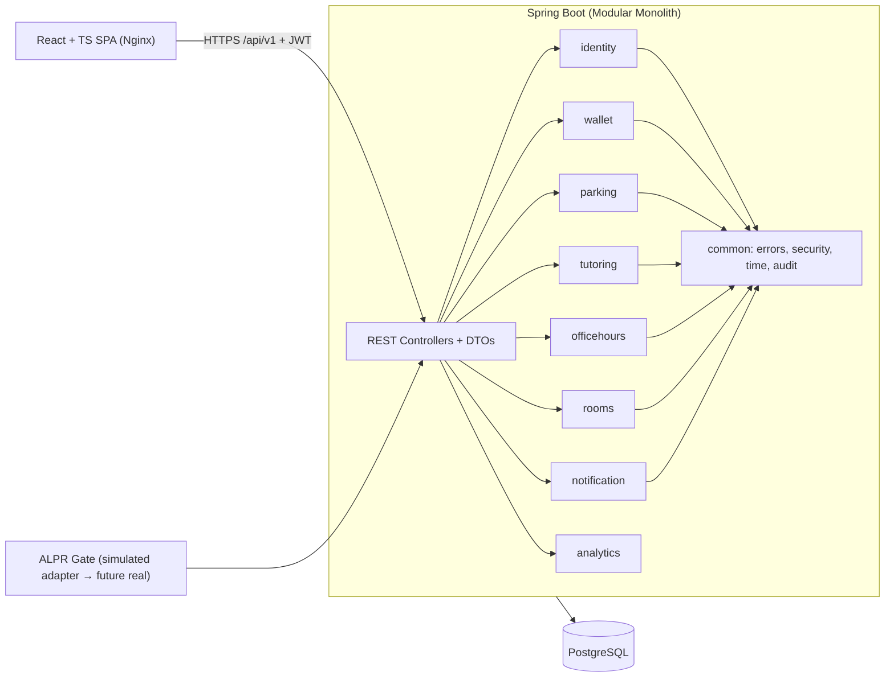

# 01 — Initial System Architecture

Status: **Proposed** (needs approval of D-1…D-3). See ADR-0001/0002.

## 1. Style: Modular Monolith

One Spring Boot deployable, strictly separated business modules, one PostgreSQL. No microservices (no scaling/team-boundary need; see ADR-0001).



## 2. Backend package layout

```
backend/src/main/java/sa/edu/fbsu/campus/
  common/        (error handling, security config, audit, clock, base entities)
  campus/        (university/tenant, colleges, buildings, terms)
  identity/      (users, roles, vehicles, auth, JWT)
  wallet/        (accounts, ledger, tuition)
  parking/       (zones, spots, tariffs, bookings, flex-share, gate)
  tutoring/      (courses, sessions, enrollments, reviews)
  officehours/   (faculty profiles, windows, appointments)
  rooms/         (rooms, bookings)
  notification/  (in-app notifications)
  analytics/     (read-only queries)
each module:  api/ (controller+DTO) · application/ (services) · domain/ (entities, rules) · infra/ (repositories, adapters)
```
Rules (enforced with **ArchUnit**): `api → application → domain`; modules interact only through `application` interfaces/events; no cross-module repository access; entities never returned from controllers.
Cross-module reactions (e.g. booking → notification, tutoring → wallet) use synchronous application-service calls inside one transaction when money is involved, otherwise Spring application events.

## 3. API conventions
`/api/v1/...`, JSON, DTO records + Bean Validation, RFC 7807 `ProblemDetail` errors with `@RestControllerAdvice`, pagination `page,size,sort`, ISO-8601 UTC instants, `Idempotency-Key` header on money/booking POSTs, OpenAPI via springdoc at `/swagger-ui`.

## 4. Security
Spring Security stateless; access JWT (15 min) + rotating refresh token (stored hashed, HttpOnly cookie or body — ADR pending); BCrypt (strength 12); RBAC via `@PreAuthorize` + ownership checks; rate limiting on auth endpoints; CORS allow-list; security headers; audit log for money/booking events.

## 5. Data integrity highlights
- Money `NUMERIC(12,2)`, currency SAR; wallet = **append-only ledger** + cached balance with `CHECK (balance >= 0)` and optimistic lock (`@Version`).
- Booking overlap prevented in DB via exclusion constraints on `tstzrange` (`btree_gist`).
- All tenant-owned tables carry `university_id` (D-1).
- Flyway migrations only; Hibernate `ddl-auto=validate`.

## 6. RBAC matrix (proposed minimum)

| Capability | Student | Faculty | Staff | Admin |
|---|:-:|:-:|:-:|:-:|
| View spots/rooms/faculty/tutoring | ✔ | ✔ | ✔ | ✔ |
| Book parking / rooms | ✔ | ✔ | ✔ | ✔ |
| Faculty zone parking | ✖ | ✔ | [?] | ✔ |
| Flex-share own spot | ✔ | ✔ | ✔ | ✔ |
| Post tutoring session | ✔ (eligibility [?]) | ✖ [?] | ✖ | ✔ |
| Book tutoring | ✔ | ✖ [?] | ✖ | ✔ |
| Manage own office-hour slots | ✖ | ✔ | ✖ | ✔ |
| Book office hours | ✔ | ✖ | ✖ | ✔ |
| Pay tuition from wallet | ✔ | ✖ | ✖ | ✖ |
| Manage spots/rooms/tariffs/users | ✖ | ✖ | ✖ | ✔ |
| View analytics | ✖ [?] | ✖ [?] | ✖ [?] | ✔ |

## 7. Frontend architecture
`frontend/` Vite + React 18 + TS (strict). `src/app` (router, providers), `src/features/<module>` (components, hooks, api, tests), `src/shared` (ui kit, i18n, theme, http client), `styles/` (ported `style.css` tokens). Server state: TanStack Query; forms: react-hook-form + Zod; i18n: react-i18next with RTL/LTR switch; auth: in-memory access token + refresh flow; theme via body class (as today).

## 8. Infrastructure
`docker-compose.yml`: `db` (postgres:16, named volume, healthcheck `pg_isready`), `backend` (multi-stage JDK21 build → JRE runtime, non-root, healthcheck `/actuator/health`), `frontend` (Nginx serving build, proxies `/api`), one bridge network, config via `.env` (`.env.example` committed, `.env` ignored). CI (GitHub Actions): frontend lint/test/build, backend test (Testcontainers), docker build, compose smoke test.

## 9. Repository layout (target)
```
/backend  /frontend  /legacy (showcase, presentation, scripts)  /docs  /.github
docker-compose.yml  .env.example  plan.md  TASKS.md  CHANGELOG.md  CONTRIBUTING.md  README.md
```

