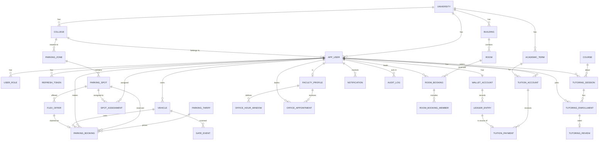

# 02 — Initial Database ERD (PostgreSQL 16)

Status: **Proposed**, to be refined per module with each schema task (P2-01, P4-01, P5-01, P6-*). Conventions: `id uuid` PK (`gen_random_uuid()`), `university_id` on tenant-owned tables (D-1), `created_at/updated_at timestamptz`, `version bigint` where concurrent updates matter, money `numeric(12,2)`, enums as `varchar + CHECK`, soft-delete only where needed.

## Core tables (key columns)

| Table | Key columns / constraints |
|---|---|
| `university` | id, code (unique), name_ar, name_en, timezone default `Asia/Riyadh` |
| `college`, `building`, `academic_term` | university_id, name_ar/en; term: start/end dates |
| `app_user` | university_id, university_number (unique per university), email?, phone, password_hash, full_name_ar/en, status, `type` (student/faculty/staff), college_id, locale, theme, specialty |
| `user_role` | user_id, role (`STUDENT`,`FACULTY`,`STAFF`,`ADMIN`, …) PK(user_id, role) |
| `vehicle` | user_id, plate_letters, plate_digits (unique per university), make_model, color |
| `refresh_token` | user_id, token_hash, expires_at, revoked_at |
| `wallet_account` | user_id unique, balance `CHECK >= 0`, currency, version |
| `ledger_entry` | account_id, amount (signed), type (`TUTORING_IN/OUT`, `FLEX_REWARD`, `TUITION`, `TOPUP`, `PARKING_FEE`, `ADJUSTMENT`), ref_type, ref_id, idempotency_key unique, balance_after, created_at — **append-only** |
| `tuition_account` | user_id, term_id, total, paid; `CHECK paid <= total` |
| `tuition_payment` | tuition_account_id, ledger_entry_id, amount, receipt_no unique |
| `parking_zone` | university_id, code (A–D), name, type (`GENERAL`,`FACULTY`,`EV`,`ACCESSIBLE`), college_id? |
| `parking_spot` | zone_id, number, distance_m, flags (ev, accessible, faculty, flex_eligible), status derived/cached |
| `spot_assignment` | spot_id, user_id, valid_from/to (primary spot) |
| `parking_tariff` | plan (`HOURLY`,`DAILY`,`MONTHLY`), price, valid range *(pending Q7)* |
| `parking_booking` | spot_id, user_id, vehicle_id, tariff_id, period `tstzrange`, price, status, flex_offer_id?; **EXCLUDE USING gist (spot_id WITH =, period WITH &&) WHERE status active** |
| `flex_offer` | spot_id, owner_id, period `tstzrange`, status, reward *(pending Q6)*; exclusion on spot+period |
| `gate_event` | plate, vehicle_id?, decision, booking_id?, occurred_at |
| `course` | university_id, code, name_ar/en, category |
| `tutoring_session` | tutor_id, course_id, covered_lectures, topics, hourly_rate, duration_hours, starts_at, location, capacity?, status |
| `tutoring_enrollment` | session_id, student_id unique pair, price, ledger_entry_id, status |
| `tutoring_review` | enrollment_id unique, rating 1–5, comment |
| `faculty_profile` | user_id unique, rank_ar/en, office, badge, topics |
| `office_hour_window` | faculty_id, weekday, start_time, end_time, slot_minutes |
| `office_appointment` | faculty_id, student_id, period `tstzrange`, topic, status; exclusion on faculty+period |
| `room` | building_id, code, name, type, capacity, specs jsonb |
| `room_booking` | room_id, lead_id, purpose, period `tstzrange`, status, extended_minutes; exclusion on room+period |
| `room_booking_member` | booking_id, user_id |
| `notification` | user_id, type, title, message, payload jsonb, read_at |
| `audit_log` | actor_id, action, entity, entity_id, details jsonb, at |

Indexes: FK columns, `(university_id, …)` composites, GiST on ranges, partial indexes on active statuses.
Seed data (dev profile only): demo users/spots/rooms derived from the current UI, anonymised per Q17.
