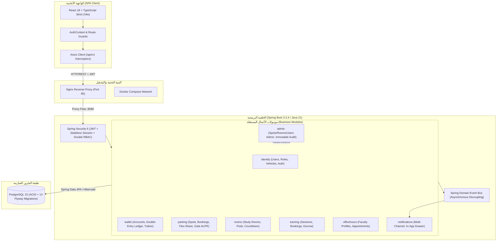

# المعمارية البرمجية للمنظومة (System Architecture) — CampusFlow
**التوثيق المعماري الفعلي والمحدث لمنظومة تشغيل الحرم الجامعي الذكي (FBSU Smart Campus OS)**

---

## 1. النمط المعماري العام (Modular Monolith)

يعتمد CampusFlow نمط **المونوليث النمطي (Modular Monolith)** المبني على مبادئ التصميم الموجه بالدومين (Domain-Driven Design). 
النظام ليس ميكروسيرفيس عشوائي ولا مونوليث متشابك تقليدي (Big Ball of Mud)؛ بل هو تطبيق واحد عالي التماسك (High Cohesion) مقسم لموديولات أعمال مستقلة تماماً داخل نفس الـ JVM، تتواصل عبر Interfaces محددة وأحداث غير متزامنة (Spring Application Events).



---

## 2. موديولات الأعمال (Module Breakdown)

1. **`sa.edu.fbsu.campus.identity`:** إدارة المستخدمين، أدوار الصلاحيات (`STUDENT`, `FACULTY`, `CAMPUS_ADMIN`, `STAFF`)، التحقق من كلمات المرور، توكنات الـ JWT وتجديدها، وإدارة المركبات واللوحات السعودية.
2. **`sa.edu.fbsu.campus.wallet`:** المحفظة الجامعية ودفتر الأستاذ المحاسبي مزدوج القيد، وضبط التزامن التشاؤمي لمنع السحب على المكشوف، وموديول فرعي `tuition` لإصدار الفواتير وسداد الرسوم.
3. **`sa.edu.fbsu.campus.parking`:** إدارة 30 موقفاً للسيارات، حساب التسعيرات، حجز المواقف والتصاريح، تبادل المواقف الذكي (AI Flex-Share)، وخوارزمية فحص لوحات البوابات (ALPR Gate Engine).
4. **`sa.edu.fbsu.campus.rooms`:** غرف المذاكرة والبودات التفاعلية وتمديد الفترات وإخلاء الغرف.
5. **`sa.edu.fbsu.campus.tutoring`:** شبكة دروس التقوية الطلابية ونشر الجلسات وحجز المقاعد.
6. **`sa.edu.fbsu.campus.officehours`:** الساعات المكتبية للأساتذة وجدولة المواعيد.
7. **`sa.edu.fbsu.campus.notifications`:** التقاط أحداث النظام وتوليد التنبيهات وإدارتها.
8. **`sa.edu.fbsu.campus.common.audit`:** سجل تدقيق أمني غير قابل للحذف (Immutable Append-Only) يرصد كل حركة إدارية.

---

## 3. المعمارية الأمنية (Security Architecture)

- **المصادقة عديمة الحالة (Stateless JWT Authentication):**
  - Access Token قصير الأجل (15 دقيقة) مشفر بتوقيع HMAC-SHA256.
  - Refresh Token طويل الأجل (7 أيام) مشفر ومخزن في قاعدة البيانات مع دعم دورة الاستبدال (Token Rotation) والإلغاء الفوري.
- **الحماية المزدوجة بالصلاحيات (Double-Layer RBAC):**
  - **الطبقة الأولى (Network / Filter Layer):** في `SecurityConfig.java`:
    ```java
    .requestMatchers("/api/v1/admin/**").hasRole("CAMPUS_ADMIN")
    .requestMatchers("/api/v1/auth/**", "/api/v1/parking/spots/**").permitAll()
    ```
  - **الطبقة الثانية (Method Security Layer):** عبر تعليقات `@PreAuthorize` على مستوى الـ Controllers والـ Services:
    ```java
    @PreAuthorize("hasRole('CAMPUS_ADMIN')")
    ```
- **حماية البيانات المالية (Concurrency & Concurrency Protection):**
  - استخدام **Pessimistic Write Locks (`SELECT ... FOR UPDATE`)** في عمليات المحفظة وحجز المواقف لمنع حدوث Double-Spending أو Double-Booking عند التزامن العالي.

---

## 4. الحوكمة المعمارية (ArchUnit Architecture Governance)
تخضع معمارية الكود لفحص صارم آلي في ملف `ArchitectureGovernanceTest.java` يضمن:
1. **عزل الموديولات (Module Isolation):** منع أي استيراد دائري (Cyclic Dependency) بين الموديولات.
2. **قواعد الطبقات (Layer Rules):** الـ Controllers لا تتصل بالـ Repositories مباشرة بل تمر عبر الـ Services حصراً.
3. **سلامة الكيانات (Entity Encapsulation):** حظر تعديل الحقول المالية دون قيد محاسبي مقابل في الدفتر.

