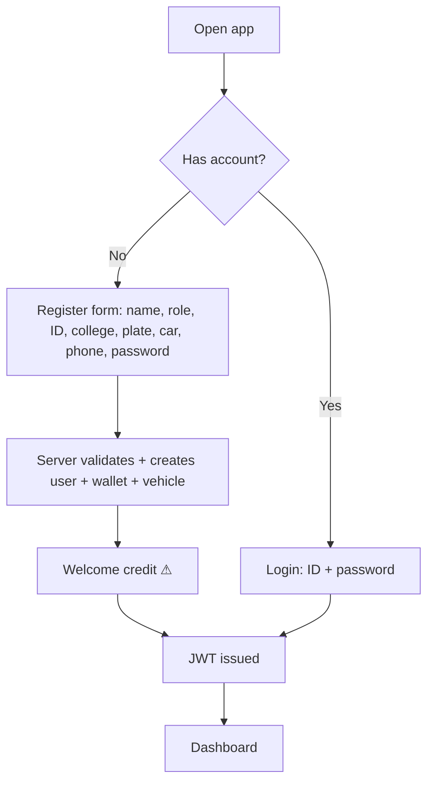
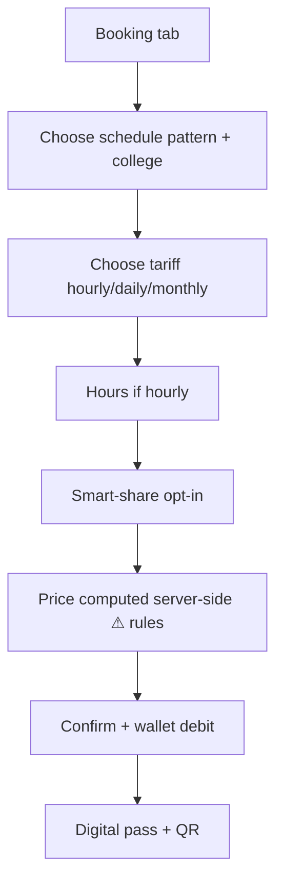
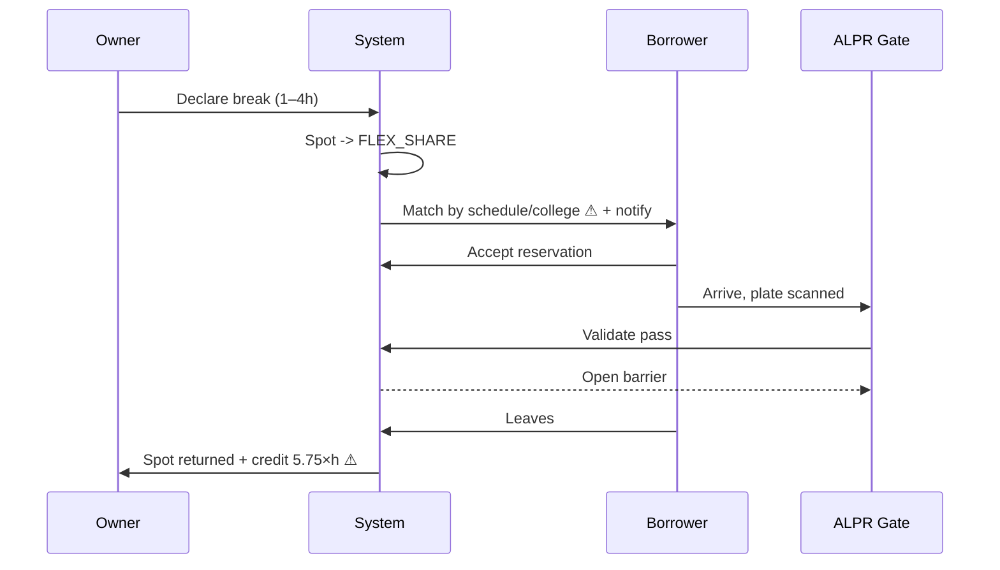
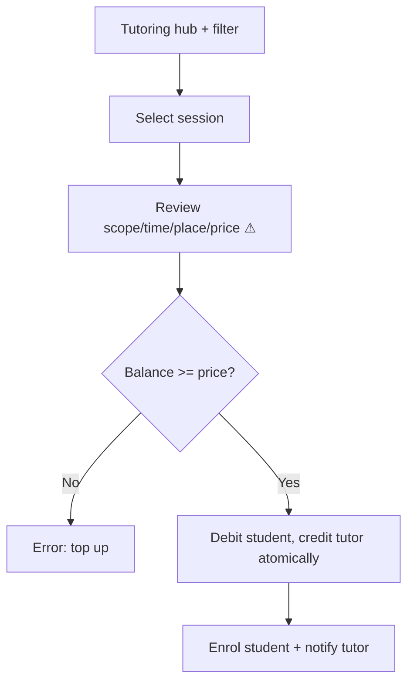

# 04 — User Flows

Flows below mirror what the current UI does; ⚠ marks steps whose rule is undefined.

## UF-1 Register & login

## UF-2 Book a parking pass

## UF-3 Flex-Share (owner → borrower)

## UF-4 Book peer tutoring

## UF-5 Tutor posts session
Tutor → "Create session" → course, scope, rate, location → publish → appears in hub.

## UF-6 Book faculty office hour
Faculty list → choose slot → topic + duration → confirm → slot booked → notification to faculty.

## UF-7 Book study room / lab
Rooms list → choose room → purpose + members + start/end → confirm → status in-use + countdown → extend +10 min / release.

## UF-8 Wallet & tuition
Wallet → view balance & history → Pay tuition → choose amount ≤ balance → confirm → ledger entry + tuition paid ↑ → receipt.

## UF-9 Notifications
Event (booking/payment) → notification row for target → bell badge → drawer → mark read.

