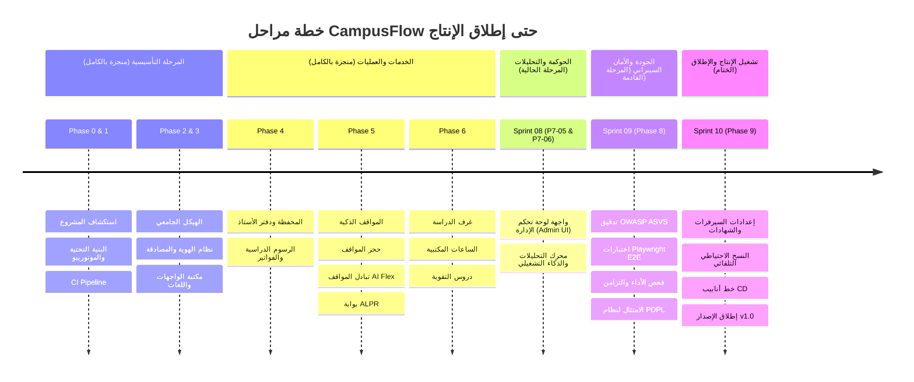

# خارطة الطريق الرئيسية للمنتج (Master Roadmap) — CampusFlow
**من الوضع الراهن إلى إطلاق الإصدار الإنتاجي الكامل (v1.0 Production Release)**

---

## 1. الرؤية الزمنية والمراحل الإستراتيجية (Phased Strategy)

---

## 2. تفصيل مراحل خارطة الطريق

### المرحلة الأولى: التأسيس والبنية التحتية (Phases 0–3) — [مكتملة 100%]
- **الهدف:** تأسيس المونوريبو الحديث، وحاويات الدوكر، وقاعدة بيانات PostgreSQL، وموديولات الهوية، والمصادقة بـ JWT، ومكتبة المكونات العربية والإنجليزية.
- **المهام المنجزة:** من `P0-01` حتى `P3-05` (17 مهمة).
- **الميزات المفعلة:** `F-01`, `F-02`, `F-03`.

### المرحلة الثانية: المالية وحركة الحرم الجامعي (Phases 4–5) — [مكتملة 100%]
- **الهدف:** بناء محفظة نقدية غير قابلة للتلاعب (Double-entry ledger)، سداد فواتير الرسوم، منظومة المواقف الذكية التفاعلية برسم السيارات الواقعي (PR #41)، معالج الحجز، تبادل المواقف الذكي (AI Flex-Share)، ومحاكي بوابات قراءة اللوحات (ALPR).
- **المهام المنجزة:** من `P4-01` حتى `P5-09` (14 مهمة).
- **الميزات المفعلة:** `F-04`, `F-05`, `F-06`, `F-07`, `F-08`, `F-09`.

### المرحلة الثالثة: الخدمات الأكاديمية والتنبيهات (Phases 6–7A) — [مكتملة 100%]
- **الهدف:** شبكة دروس التقوية P2P، حجز الساعات المكتبية للأساتذة، غرف الدراسة التفاعلية بعداد تنازلي، مركز الإشعارات الموحد، والخلفية البرمجية للوحة الإدارة وسجل التدقيق (PR #40).
- **المهام المنجزة:** من `P6-01` حتى `P7-04` (11 مهمة).
- **الميزات المفعلة:** `F-10`, `F-11`, `F-12`, `F-13`، وخلفية `F-14`.

### المرحلة الرابعة: الحوكمة والتحليلات (المرحلة الحالية — Sprint 08)
- **الهدف:** إكمال واجهة لوحة التحكم الإدارية وربط شاشات التحليلات بالبيانات الحية.
- **المهام:**
  1. `P7-05: Admin UI`: بناء شاشات إدارة المواقف، غرف الدراسة، التسعيرات، المستخدمين، وسجل التدقيق الأمني، وربطها بالـ API المكتمل.
  2. `P7-06: Analytics Backend & Integration`: بناء مسارات إحصائيات الإشغال والإيرادات وربطها بـ `AnalyticsView.tsx`.
- **الميزات المستهدفة:** إكمال `F-14` و `F-15` إلى 100% VERIFIED.

### المرحلة الخامسة: الجودة والأمان السيبراني (Sprint 09 — Phase 8)
- **الهدف:** فحص الثغرات وفق OWASP ASVS، وبناء سويت اختبارات E2E شامل عبر Playwright باللغتين العربية والإنجليزية، وفحص التوافقية وسهولة الاستخدام (WCAG 2.1 AA)، ومحاكاة الضغط والتزامن العالي (Concurrency Load Testing) على المحفظة وحجز المواقف، وتطبيق معايير حماية البيانات الشخصية السعودية (PDPL).
- **المهام:** `P8-01`, `P8-02`, `P8-03`, `P8-04`, `P8-05` (5 مهام).
- **الميزات المستهدفة:** تفعيل `F-16` (الجزء الأول).

### المرحلة السادسة: جاهزية الإنتاج والإطلاق (Sprint 10 — Phase 9)
- **الهدف:** تكوين الإنتاج الآمن (Production Docker Compose مع Nginx SSL/TLS وإدارة الـ Secrets)، وأتمتة خط النشر المستمر (CD Pipeline)، وجدولة النسخ الاحتياطي التلقائي للداتابيز، وتجهيز أدلة التشغيل (Runbooks) وإعلان الإصدار الرسمي v1.0.
- **المهام:** `P9-01`, `P9-02`, `P9-03`, `P9-04` (4 مهام).
- **الميزات المستهدفة:** إطلاق المنتج بالكامل.

