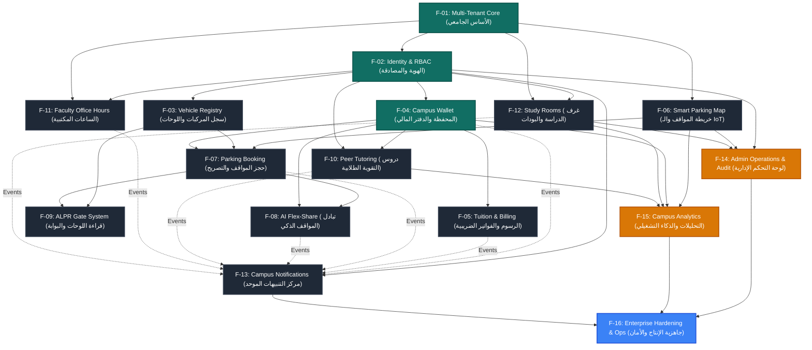

# خريطة اعتماديات الميزات (Feature Dependency Map) — CampusFlow
**شبكة العلاقات والمسار الحرج (Critical Path) بين جميع ميزات النظام الـ 16**

---

## 1. مخطط الاعتماديات التفاعلي (Mermaid Dependency Graph)



---

## 2. جدول تحليل الاعتماديات التفصيلي (Dependency Register)

| Feature A (المعتمدة) | Feature B (المعتمد عليها) | نوع العلاقة | سبب الاعتماد | هل إجباري أم اختياري؟ | هل A تسبق B بالضرورة؟ | إمكانية التطوير بالتوازي |
|---|---|---|---|---|---|---|
| **F-02: الهوية والمصادقة** | F-01: أساس الحرم | Structural | ربط المستخدم بكود الجامعة والكليات | إجباري | نعم (B تسبق A) | ممكن جزئياً بعد تحديد كود الجامعة |
| **F-03: سجل المركبات** | F-02: الهوية والمصادقة | Ownership | كل مركبة مملوكة لمستخدم مصدق | إجباري | نعم | لا |
| **F-04: المحفظة والدفتر** | F-02: الهوية والمصادقة | Financial Subject | المحفظة ترتبط بهوية المستخدم | إجباري | نعم | نعم بتجهيز الـ Schema أولاً |
| **F-05: الرسوم الدراسية** | F-04: المحفظة والدفتر | Payment Gateway | خصم مبالغ الفواتير من رصيد المحفظة | إجباري للسداد (اختياري للعرض) | نعم للسداد | ممكن تطوير واجهات العرض بالتوازي |
| **F-06: خريطة المواقف** | F-01: أساس الحرم | Spatial Anchor | المواقف تنتمي لقطاعات ومباني الكليات | إجباري | نعم | نعم بمجرد وجود جدول المباني |
| **F-07: حجز المواقف** | F-06: خريطة المواقف | Inventory Source | لا يمكن حجز موقف بدون معرفة حالته | إجباري | نعم | لا |
| **F-07: حجز المواقف** | F-04: المحفظة والدفتر | Payment Source | خصم تسعيرة الموقف فورياً من المحفظة | إجباري | نعم | نعم |
| **F-07: حجز المواقف** | F-03: سجل المركبات | Subject Identifier | ربط الحجز برقم لوحة السيارة الفعلي | إجباري | نعم | نعم |
| **F-08: تبادل المواقف** | F-07: حجز المواقف | Asset Source | الموقف المعروض يجب أن يكون محجوزاً أولاً | إجباري | نعم | لا |
| **F-08: تبادل المواقف** | F-04: المحفظة والدفتر | Reward Credit | إيداع مكافأة المشاركة المالية للدكتور | إجباري | نعم | نعم |
| **F-09: بوابة الدخول ALPR** | F-07: حجز المواقف | Access Verification | التحقق من وجود تصريح سارٍ عند الوصول | إجباري | نعم | نعم |
| **F-09: بوابة الدخول ALPR** | F-03: سجل المركبات | Plate Matching | مطابقة اللوحة المقروءة بصرياً ببيانات النظام | إجباري | نعم | نعم |
| **F-10: دروس التقوية** | F-04: المحفظة والدفتر | Financial Transfer | دفع تكلفة الحصة وتحويلها للمدرب | إجباري | نعم | نعم |
| **F-10: دروس التقوية** | F-02: الهوية والمصادقة | Role Verification | المدرب والطالب يجب أن يكونا مسجلين | إجباري | نعم | لا |
| **F-11: الساعات المكتبية** | F-02: الهوية والمصادقة | Role Verification | الأستاذ يملك دور FACULTY والطالب STUDENT | إجباري | نعم | لا |
| **F-11: الساعات المكتبية** | F-01: أساس الحرم | Location Anchor | تحديد مكتب الدكتور في مبنى الكلية | إجباري | نعم | نعم |
| **F-12: غرف الدراسة** | F-02: الهوية والمصادقة | Booking Identity | الغرفة تحجز باسم طالب جامعي | إجباري | نعم | لا |
| **F-12: غرف الدراسة** | F-01: أساس الحرم | Location Anchor | الغرف تقع داخل مباني المكتبة والكليات | إجباري | نعم | نعم |
| **F-13: مركز التنبيهات** | F-02: الهوية والمصادقة | Recipient Target | التنبيه يوجه لمعرف المستخدم | إجباري | نعم | لا |
| **F-13: مركز التنبيهات** | F-04 إلى F-12 | Event Producers | التقاط أحداث الحجز والمدفوعات والمواعيد | اختياري (Loose Coupling عبر الأحداث) | لا (تتفاعل تلقائياً) | نعم بالتوازي بالكامل |
| **F-14: لوحة التحكم الإدارية** | F-02: الهوية | RBAC Gate | صلاحية CAMPUS_ADMIN حصراً | إجباري | نعم | لا |
| **F-14: لوحة التحكم الإدارية** | F-06, F-12 | Managed Assets | إدارة المواقف والغرف والتسعيرات والمستخدمين | إجباري | نعم (الخلفية مكتملة) | **الواجهة هي الخطوة القادمة (P7-05)** |
| **F-15: التحليلات والذكاء** | F-06, F-04, F-12 | Data Producers | تجميع إحصائيات الإشغال والإيرادات والاستخدام | إجباري | نعم | نعم (تتطلب اكتمال العمليات السابقة) |
| **F-16: جاهزية الإنتاج** | F-01 إلى F-15 | System Subject | الفحص الشامل والأمان واختبارات E2E للنظام كاملاً | إجباري | نعم | لا |

---

## 3. المسار الحرج للمشروع (The Critical Path)

المسار الحرج الذي يحدد جاهزية النظام الحقيقية ويمنع أي تأخير غير مبرر:

```
[F-01: Multi-Tenant Core] 
          ↓ (مكتمل)
[F-02: Identity & RBAC] 
          ↓ (مكتمل)
[F-04: Digital Wallet & Ledger] 
          ↓ (مكتمل)
[F-06: Parking Core & F-07: Booking] 
          ↓ (مكتمل)
[F-14: Admin Operations & Governance] ◄── [نحن هنا الآن: Backend مكتمل، واجهة P7-05 مطلوبة]
          ↓
[F-15: Campus Analytics & Intelligence] ◄── [المهمة التالية P7-06]
          ↓
[F-16: Enterprise Hardening, Security Review & Production Deploy] ◄── [المرحلة الأخيرة P8 & P9]
```

### خلاصة المسار الحرج:
1. **الأساس البنيوي (Foundation Layer):** مكتمل بنسبة 100% ومفحوص (المصادقة، المحفظة، الهيكل الجامعي، تسجيل المركبات).
2. **الخدمات التشغيلية للمستخدمين (Operational Services):** مكتملة بنسبة 100% ومربوطة بالواجهات (المواقف، حجز المواقف، البوابات، الفلكس، الرسوم، الساعات المكتبية، غرف الدراسة، دروس التقوية، التنبيهات).
3. **عنق الزجاجة الحالي (Current Bottleneck):** لوحة تحكم الإدارة `F-14` (الخلفية وسجل التدقيق جاهزة 100%، لكن الواجهة `Admin UI - P7-05` لم تُبنَ بعد). بناء واجهة الإدارة يفتح الباب فوراً لإكمال التحليلات `F-15` ثم الانطلاق لمرحلة الإنتاج والأمان `F-16`.
